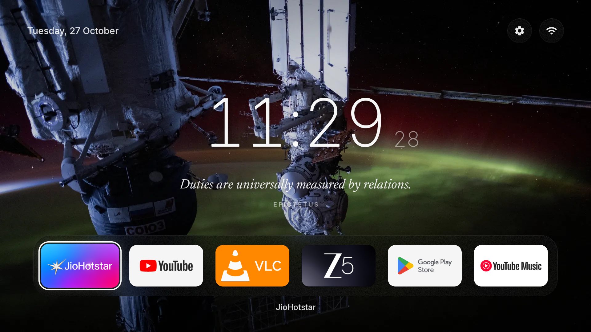
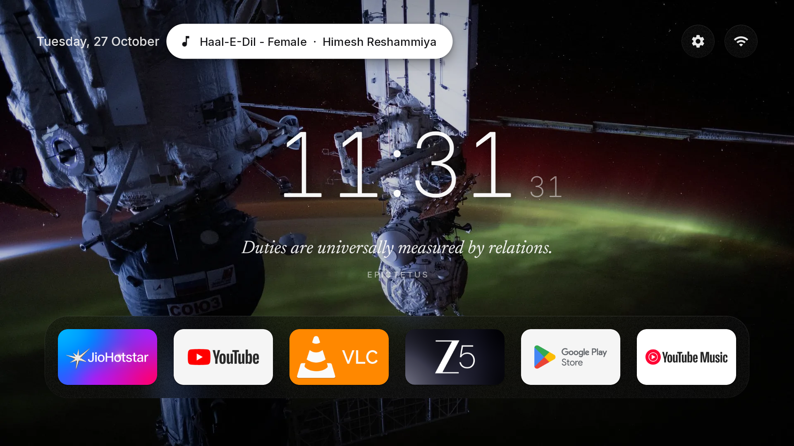
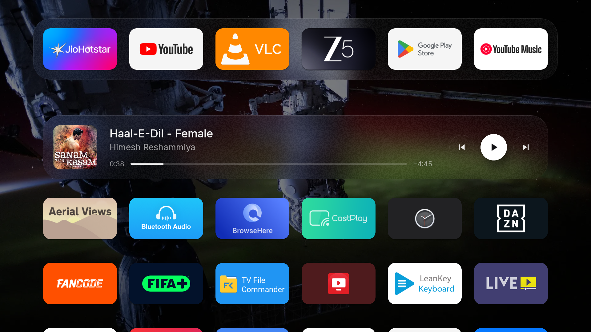
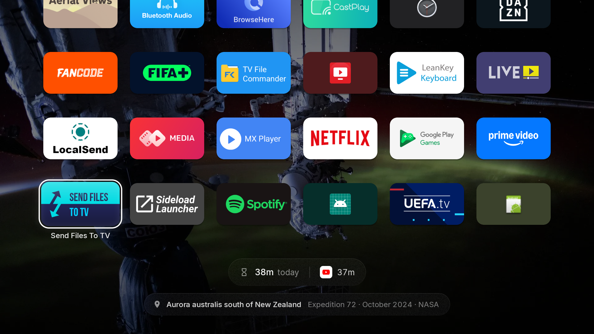
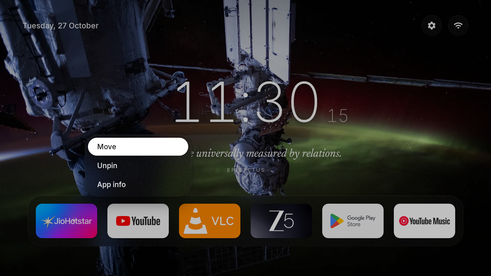
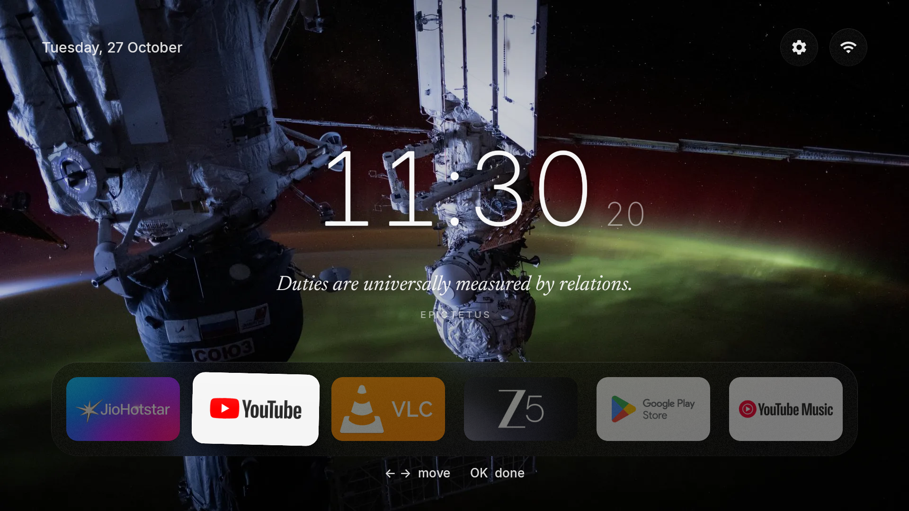

# Glass

A calm, minimal launcher for Android TV, plus a reversible de-bloat of a realme Smart TV (Android TV 11).



## Features

- **Home**: daily NASA night photo from the ISS, clock with rolling seconds, a Stoic quote each day, glass dock of pinned apps with a sliding focus ring
- **Scroll down**: the rest of your apps, a Now Playing card, today's screen time
- **Hold OK** on an app: Move, Unpin / Pin to dock, App info
- **Wallpaper picker**: 25 photos, or a new one every day
- **Private**: no ads, no tracking, no `INTERNET` permission

| | |
|---|---|
|  |  |
|  |  |
|  |  |

## Build & install

Kotlin + Jetpack Compose, `minSdk 30`. Needs JDK 17 and the Android SDK.

```sh
cd launcher
ANDROID_HOME=~/Android/Sdk ./gradlew assembleRelease
adb install -r app/build/outputs/apk/release/app-release.apk

# Optional: Now Playing card and screen time
adb shell cmd notification allow_listener com.geekyabs.glass/com.geekyabs.glass.MediaListener
adb shell appops set com.geekyabs.glass GET_USAGE_STATS allow

# Optional: make Glass the only Home app
adb shell pm disable-user --user 0 com.google.android.tvlauncher
```

## Undo

Every change made to the TV is logged in [`changes.log`](changes.log). [`restore.sh`](restore.sh) puts the TV back to its original state (from [`backup/`](backup)): it re-enables removed apps, restores the stock launcher, uninstalls Glass and reboots.

```sh
./restore.sh <tv-ip>:5555    # or an adb serial for USB
```

## Credits

Photos: NASA (public domain). Fonts: [Inter](https://rsms.me/inter/) and [Newsreader](https://github.com/productiontype/Newsreader) (OFL, see [`licenses/`](licenses)). Icons: Material Icons (Apache 2.0). Quotes: public-domain translations of Marcus Aurelius, Seneca and Epictetus.
